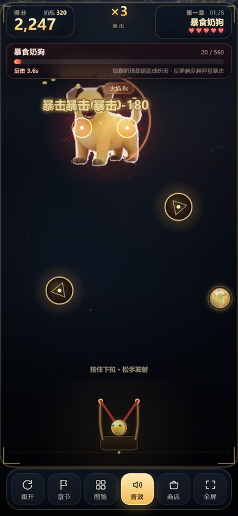
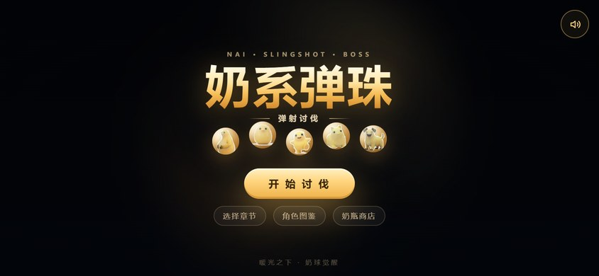
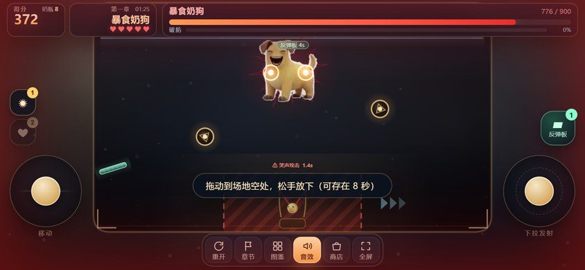
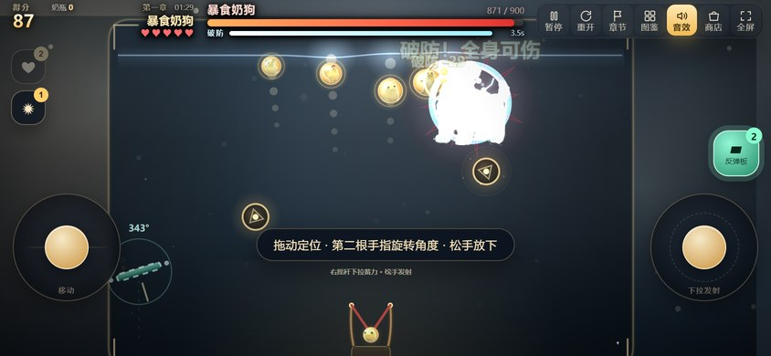
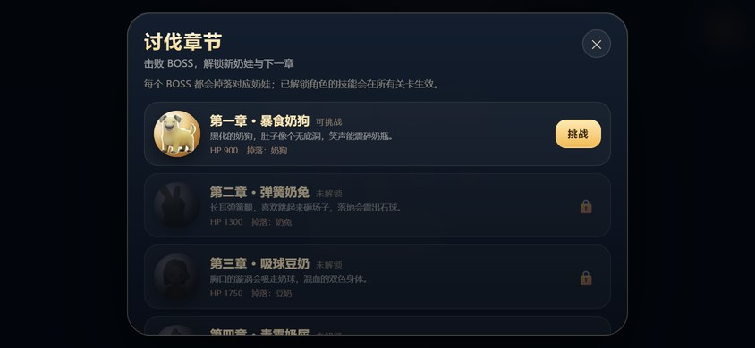
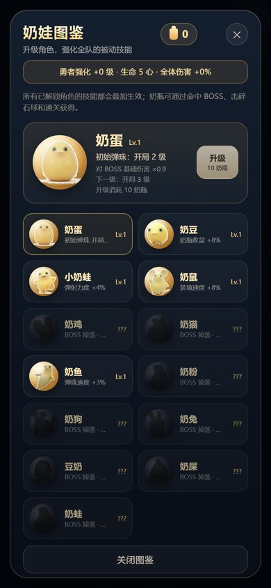
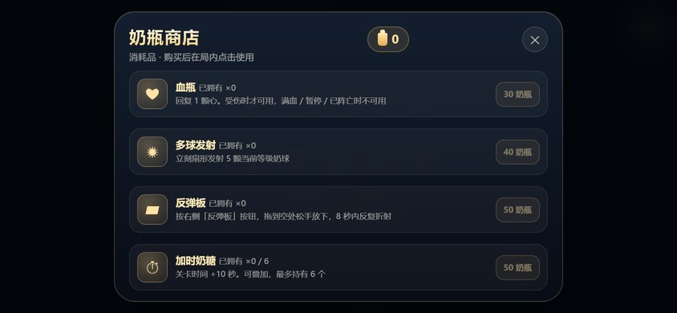
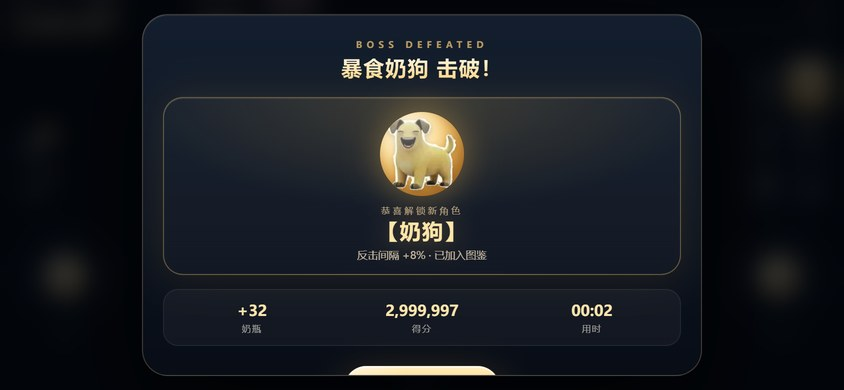

# 奶系弹珠 · 弹射讨伐

弹弓 × 合成 × 打 Boss。拖拽蓄力发射奶球，相同奶球碰撞合体；**所有等级都能伤害 Boss**，
而且**奶球命中 Boss 后不会被消耗**，会弹开继续留在场上——所以可以一直弹、一直合，
把 2 级球养成 6~8 级的大杀器。



## 打开

双击 `奶系弹珠_弹射讨伐.html`（Chrome / Edge / Safari / 微信）。单文件离线可玩，手机竖屏最佳。

素材使用 WebP，需要 Safari 14+ / iOS 14+；Chrome、Edge、安卓微信不受限制。

## 操作

- **按住屏幕向下拉，松手发射**；拉满时拉杆/预测线变红并显示 `MAX`。
- **炮台左右移动**：屏幕下方 ◄ ► 按钮按住移动，或键盘 A / D、← / →。
- 空格 = 满力向上；R 重开，L 章节，G 图鉴，Esc 关闭弹窗。

## 核心机制

- **场地**：宽度随屏幕高度放开（最宽约 860），物体按宽、高中更紧的一边缩放，横屏/桌面不再出现「大球挤在矮场地里」。机关贴着左右墙摆，中间留出发射通道。
- **不消耗**：奶球打中 Boss 只扣血、弹开，并进入 0.7 秒的再次命中冷却，球不会消失；
  只有撞墙/机关改变方向，合体时才会变成新球。
- **Boss 预判闪避**：Boss 会预判来球，向反方向冲刺或闪现；闪避率随章节 55% → 88%。
- **狂暴**：Boss 血量低于阈值（50% → 62%，随章节提高）进入狂暴，攻击更快，BGM 变激烈。
- **勇者生命**：基础 5 心，角色升级后最高 10 心；Boss 反击命中扣 1~3 心，心归零失败。
- **蓄力 + 闪避**：Boss 蓄力时会锁定你当前位置，画出红色危险区并提示安全方向；蓄力结束前走出红区就闪避成功，每连续闪避 3 次送奶瓶。蓄力期间打够伤害也能打断。
- **破防**：打 Boss 身体造成 35% 伤害并积累破防条；破防条满后 Boss 硬直 3.5 秒，不动不闪、不反击，全身都算弱点，受伤 ×1.3。每破防一次，下一次的需求 ×1.35。
- **左右两块弱点板**：打中造成 ×1.5 满额伤害，不积累破防。
- **弹力顶棚**：HUD 下沿是一根发光弦，球撞上会弹回来再打一次 Boss（不计入反弹暴击）；只有掉出底部才消耗。
- **出膛穿透**：刚发射的球 0.16 秒内穿过其他球，不会在发射口被场上的球挡住。
- **反弹暴击**：撞墙/弹簧/传送门/弹珠台都会累积反弹数；4 次反弹必暴击（×1.8），
  反弹越多基础伤害越高（最高 ×2.2）。
- **全员输出**：伤害 = 等级基础值 × 角色伤害倍率 × 被动 × 反弹/暴击/弱点；
  每只奶娃的基础倍率不同（0.9 ~ 1.6），图鉴里可查。

## 八个章节

| 章节 | Boss | 攻击 | 血量 / 限时 | 解锁 | 技能 |
| --- | --- | --- | --- | --- | --- |
| 一 · 暴食奶狗 | 黑化奶狗 | 笑声攻击（哈哈哈声波） | 900 / 90s | 奶狗 | 反击间隔 +8%/级 |
| 二 · 弹簧奶兔 | 长耳奶兔 | 弹簧跳砸（落地震石球）+ 闪避 | 1300 / 85s | 奶兔 | 弹射力度 +6%/级 |
| 三 · 吸球豆奶 | 双色豆奶 | 吸星漩涡（吸球） | 1750 / 80s | 豆奶 | 奶瓶收益 +12%/级 |
| 四 · 毒雾奶屎 | 塔状奶屎 | 臭屁攻击（绿气 + 屏幕泛绿） | 2250 / 75s | 奶屎 | 反击间隔 +6%/级 |
| 五 · 暴食奶粉 | 巨型奶粉 | 泰山压顶（高跳砸地） | 2750 / 70s | 奶粉 | 对 BOSS 伤害 +6%/级 |
| 六 · 幻影奶猫 | 幻影奶猫 | 幻影光束（锁定列）+ 高速闪避 | 3350 / 65s | 奶猫 | 暴击率 +3%/级 |
| 七 · 尖叫奶鸡 | 尖叫奶鸡 | 蛋蛋轰炸（满场炸弹蛋） | 3950 / 60s | 奶鸡 | 开局赠球 +1/级 |
| 八 · 终焉奶蛙 | 雷霆奶蛙 | 雷霆万钧（雷柱 + 狂暴游走） | 4600 / 60s | 奶蛙 | 全伤害 +6%/级 |

难度随章节递增：攻击间隔 7.6s→3.7s，蓄力 1.45s→0.85s，危险区越来越宽，第 4 章起 2 连段、第 7 章起 3 连段（后续段伤害 -1），破防需求 7%→13% 血量。反击伤害 1/1/1/2/2/2/2/3 心。
每关的地面机关逐步解锁：弹簧板（1.7×）、上下传送门、顶部弹力墙、两个旋转弹珠台。

## 道具与增益

- **超级奶娃**：10 秒，发射奶球等级 +3、伤害 ×1.8，弹弓变金色超级形态。
- **奶瓶护盾**：抵挡下一次 Boss 反击。
- **狂暴**：8 秒，全伤害 ×2。

场地会刷新发光道具，用奶球撞到即可拾取。

## 图鉴与养成

- 13 位奶娃，8 位由 Boss 掉落（奶狗/奶兔/豆奶/奶屎/奶粉/奶猫/奶鸡/奶蛙），5 位默认解锁。
- 未解锁显示黑色剪影；**所有已解锁角色技能叠加**；升级 Lv.1~Lv.5，消耗 10/18/28/40 奶瓶。
- **角色升级同时强化勇者**：每投入 1 级强化，生命 +1 心（上限 10）、全体伤害 +3%（上限 +50%），图鉴顶部实时显示。
- 进度/奶瓶/解锁/等级存 `localStorage`（`nai_boss_meta`）。

## 奶瓶商店（消耗品）

底部「商店」或开场「奶瓶商店」进入。用奶瓶购买，**买一次用一次**，可叠加存放；购买记录会存档。
普通道具在**左侧道具栏**点击使用，反弹板改用**右下角专用按钮**。

| 道具 | 价格 | 效果 |
| --- | --- | --- |
| 血瓶 | 30 | 回复 1 颗心。只在受伤时可用，满血 / 暂停 / 已阵亡时按钮置灰、点了也不消耗；0.5 秒冷却防连按 |
| 多球发射 | 40 | 扇形发射 5 颗当前等级奶球 |
| 反弹板 | 50 | 点右下「反弹板」按钮进入放置模式，**拖到场地空处松手放下**；存在 8 秒，每次折射 +1 反弹数 |
| 火焰灼烧 | 60 | 8 秒内所有伤害 +50% |
| 传送阵 | 70 | 任何关卡临时开一对传送阵，20 秒 |
| 雷电球 | 80 | 3 道雷击，高额伤害并积累破防 |
| 变身超级奶娃 | 90 | 12 秒内发射等级 +3、伤害 ×1.8，弹弓变金色 |

反弹板的长度限制在场宽的 13% 以内（约 51 px）并带轻微倾斜——太长或水平的挡板会把上行的奶球
直接弹回去，反而挡住进攻。

## 音效

- **程序化 BGM**：Web Audio 实时合成（低音 + 和声 + 鼓点），平静 / 狂暴 / 蓄力三档强度自动切换。
- **结算音效（循环播放）**：两条独立音轨，都设 `loop=true` 循环到玩家离开结算界面为止。
  - 胜利：`assets/laugh.mp3`（9.1 秒笑声），音量 0.72。
  - 失败：`assets/lose.mp3`（16.6 秒），音量 0.62。
  - 失败音在转码时已压 −3 dB、并对 7 kHz 以上削 4 dB——源文件峰值顶到 0 dB（已削顶），
    原样播放会很刺耳；播放音量也比胜利音低一档。
  - 进下一关 / 重开 / 关掉音效都会立即停止；若被浏览器自动播放策略拦下，会在玩家下一次点击/按键时补播。
- 奶球相撞：玻璃碰撞声；合成：噗叽声；命中 Boss：打击声；破防、反弹板、传送阵、变身各有专属音效。
- 音效开关同时控制 BGM、结算音效与音效。

## 画面

- **动态背景**：不再用静态图，改成程序化生成的场景——两层柔光云以不同速度反向漂移，叠加缓慢上浮的
  奶滴粒子，并随开场有缩放呼吸。场地留了透光，暖金色光晕会从场地内部透出来；零素材开销。
  两层云在 resize 时预渲染成离屏画布，每帧只做两次 `drawImage`。
- 奶球速度拖尾；破防 / 暴击合体 / 变身 / 击破时短暂慢放。
- 全屏闪光按事件着色：破防青、暴击金、受伤红、雷电蓝。
- 预测线与真实命中判定一致，飞出上下边界处截止。

## 操作与开场

- 点击场地空白处向上发射中等力度球；拖动可瞄准，蓄力显示百分比。
- 顶部 HUD 区域点击不会误发射；发射/合体/受击有轻震动。
- 右下角「反弹板」按钮：按一下进入放置模式，在场地里拖动、松手放下；再按一下取消。
- 左侧道具栏点击使用消耗品；血瓶在满血或冷却中会置灰。

## 画面预览

| 开始 | 开场 VS | 战斗 |
|:---:|:---:|:---:|
|  |  |  |

| 危险区 / 闪避 | 反弹板放置 | 讨伐章节 |
|:---:|:---:|:---:|
|  |  |  |

| 角色图鉴 | 奶瓶商店 | 胜利结算 |
|:---:|:---:|:---:|
|  |  |  |

## 工程结构

```
my_game/
├─ src/parts/              源码（按分节拆开，构建时拼回单文件）
│  ├─ index.html           骨架：head + body + <style>/<script> 占位符
│  ├─ style.css            全部样式
│  ├─ manifest.json        组装顺序（唯一权威）
│  └─ js/                 01-data.js / 03-audio.js / 16-render.js …
├─ assets/                 素材：WebP 立绘 + 图鉴 + laugh.mp3 / lose.mp3；背景是程序化生成的
├─ preview/                README 截图（由 tools/shots.mjs 生成）
├─ tools/                  构建与测试工具（零依赖，无需 npm install）
├─ build.js                构建脚本
├─ 奶系弹珠_弹射讨伐.html     构建产物（单文件，双击即玩）
└─ index.html              产物别名（部署到静态站时避开中文文件名的 URL 编码）
```

## 构建

```bash
node build.js                 # 组装源码 + 内联素材 -> 单文件产物
node build.js --check         # 校验「现有产物 == 重新构建结果」，退出码 0/1，可进 CI
node build.js --emit-source   # 导出未内联素材的源码到 _source.html，便于调试
```

产物约 1.15 MB，其中 90% 是 base64 素材。构建是**可复现**的：素材遍历顺序固定、
占位符用函数式替换，同一份源码在任何机器上产出的 sha256 都一致。

`assets/laugh.mp3` 是从原始笑声视频里抽出来的纯音频轨（丢掉 1920×1080 的视频轨，
262 KB 降到 148 KB）：

```bash
ffmpeg -i <原始视频>.mp4 -vn -c:a libmp3lame -b:a 128k -ar 44100 -ac 2 assets/laugh.mp3
```

`assets/lose.mp3` 同理，另外压了电平、削了高频（源峰值顶到 0 dB，原样播放偏刺耳）：

```bash
ffmpeg -i <失败音视频>.mp4 -vn -c:a libmp3lame -b:a 128k -ar 44100 -ac 2 \
  -af "volume=-3dB,treble=g=-4:f=7000" assets/lose.mp3
```

## 架构约定（防止再出同类 bug）

游戏逻辑是单文件单作用域的，几个状态一旦有多处写入点，就很容易"改了一处漏一处"。
下面四条是硬约定，`npm run lint` 会强制检查：

| 约定 | 为什么 | 检查方式 |
| --- | --- | --- |
| 结算只经 `settleLevel(kind)` | 胜利/失败曾经各写一份，**血量归零那条漏播了结算音效** | `state.mode='victory'\|'lose'` 只允许出现在 `13-settle.js`；`playVictoryAudio/playLoseAudio` 只允许 `settleLevel` 调用 |
| 道具效果登记在 `ITEM_USE` | 新道具只改数据、不碰分发逻辑 | `SHOP_ITEMS` 与 `ITEM_USE` 的 key 必须一一对应 |
| 勇者生命只经 `setHeroHP` | 手写赋值容易漏刷心形 HUD | 除 `05-state.js` 外禁止 `state.heroHP =` |
| 刷新函数不改状态 | `refreshPlateBtn()` 曾偷偷取消放置，副作用藏得很深 | 取消逻辑移到 `update()` 的状态机里 |

道具的效果函数返回 `false` 表示"这次没生效"（冷却中/满血/只是进入放置模式），
`useItem` 据此决定要不要扣道具——扣减、存档、刷新只写一次。

## 测试

```bash
npm run lint             # 源码自检 + 上述结构约束，21 项
npm run smoke            # 无头 Edge 冒烟测试，21 项
node tools/shots.mjs     # 重新生成 preview/ 截图
```

冒烟测试通过 `tools/cdp.mjs` 直连 DevTools 协议（零依赖）。它把 `requestAnimationFrame` 换成
手动队列、`performance.now` 虚拟化成逐帧时钟、`Math.random` 固定种子——于是每次运行的游戏状态
完全一致，既能断言也能做跨版本像素对比。

覆盖内容：素材解码、画布渲染、8 个章节各跑 30 秒逻辑（不崩 / 无 NaN / 有真实命中）、
「命中 Boss 不消耗球」核心机制、胜利后存档推进、损坏存档回落、存档跨刷新保留。

## 部署到网站

单文件版适合「发给别人双击玩」，网站部署则应该用**外置资源版**——HTML 只有 219 KB，
素材单独成文件，能被浏览器缓存和 CDN 分发：

```bash
node build.js --web            # -> dist/web/  (index.html + assets/)
node build.js --web docs       # -> docs/      （提交进仓库，给 Gitee Pages 用）
```

### 方式一 · 整站托管（推荐）

仓库里已有 `docs/`，直接开 Pages 即可：

- **Gitee Pages**：仓库 → 服务 → Gitee Pages → 分支 `main`、部署目录 `docs` → 启动
  → 地址形如 `https://zjqcodex.gitee.io/nai-marble-boss/`
- 换成 GitHub Pages / Vercel / Netlify 同理（部署目录同样选 `docs`）

`docs/assets/` 与根目录 `assets/` 内容完全相同，git 会按内容去重，不会让仓库翻倍。

### 方式二 · HTML 与素材分开（素材放国内仓库）

```bash
node build.js --web dist/web-cdn \
  --asset-base "https://gitee.com/zjqcodex/nai-marble-boss/raw/main/assets"
```

产出的 `dist/web-cdn/` 只有一个 `index.html`，素材全部指向给定前缀，HTML 可以放任意托管商。
实测跨域可用（14/14 图片 + 2 条音效正常加载）。

> ⚠️ 这套方案能用，但**不如方式一快**：Gitee 的 `raw` 是文件网关而不是 CDN，
> 实测 16 个素材串行下载约 16 秒（走代理环境），且 `Cache-Control` 只有 `max-age=60`。
> 素材量不大时无所谓，追求首屏速度请用 Pages。

## 调试参数

- `?debug` —— 暴露 `window.__NAI__`（`step(n)` / `spawn()` / `setBossHp()` / `damage()` / `win()` / `lose()` 等），冒烟测试就建立在它上面。
- `?level=5` —— 直接进第 5 章。
- `?autoplay` —— 自动开打第 1 章（跳过开场）。

章节难度字段（`breakPct / dodgeW / tele / dodgeRate / combo / enragePct`）都在 `src/parts/js/01-data.js` 的 `CHAPTERS` 表里。

> `?debug` 在正式产物里同样生效。单人离线游戏无所谓，但将来若加排行榜，需要先关掉它。
